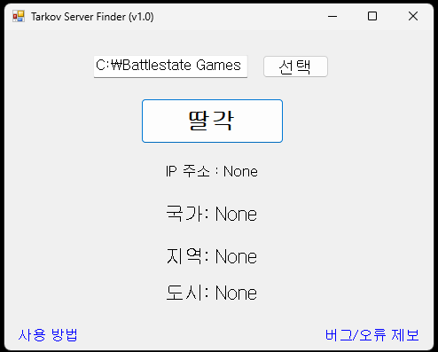
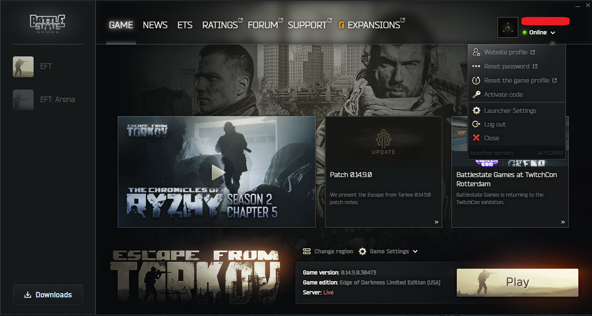
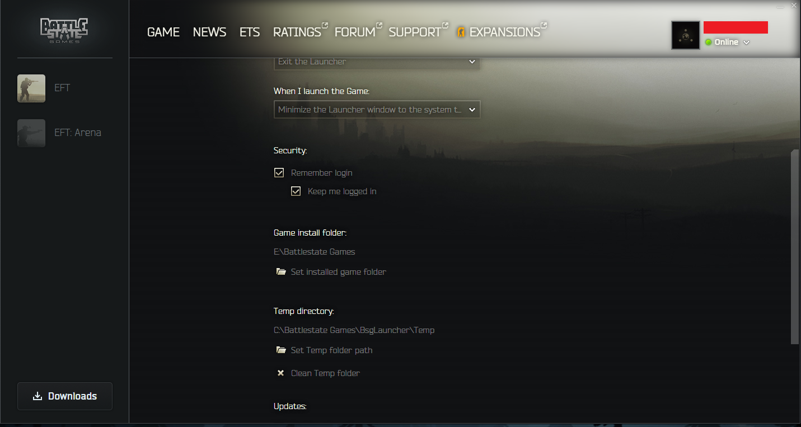

# Tarkov Server Finder

> [!WARNING]
> **이 프로젝트는 더 이상 유지되지 않습니다 (Archived)**
>
> 로그 구조 변경으로 인해 기존 기능이 더 이상 정상 동작하지 않으며,  
> 해당 기능은 아래 통합 프로젝트로 이전 및 개선되었습니다.
>
>  👉 새로운 프로젝트: https://github.com/karpitony/eft-where-am-i  
>  👉 관련 변경 사항: https://github.com/karpitony/eft-where-am-i/pull/52  
>
> 📦 **다운로드 (권장)**
> - https://github.com/karpitony/eft-where-am-i/releases/download/v2.3.2/eft-where-am-i-win-sc-Portable.zip
>
> 기존의 "서버 위치 확인" 기능은 해당 프로그램에 포함되어 있으며,  
> 추가 기능과 함께 지속적으로 업데이트됩니다.
 
## 사용 방법

**1. 프로그램 실행**

  

**2. 런쳐를 통해 어느 드라이브에 탈콥을 설치했는지 확인**

런쳐에서 프로필 클릭 > `Launcher Settings` > Game install folder 확인

  

**3. 프로그램 상단의 파일 경로를 바꾸기**
대부분이 C 드라이브라 기본 설정은 C드라이브이므로 다른 곳에 설치했다면 바꿔주기

  

**4. 매칭 잡고 `딸각` 버튼 누르기**
